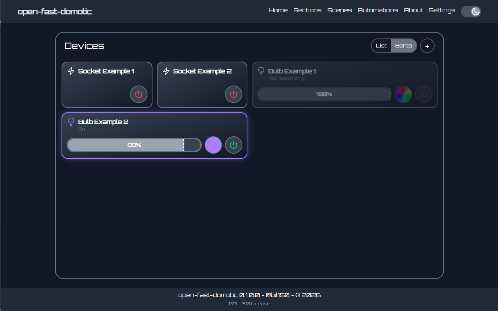
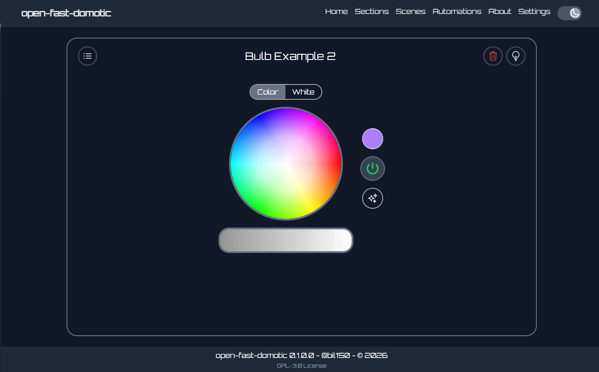
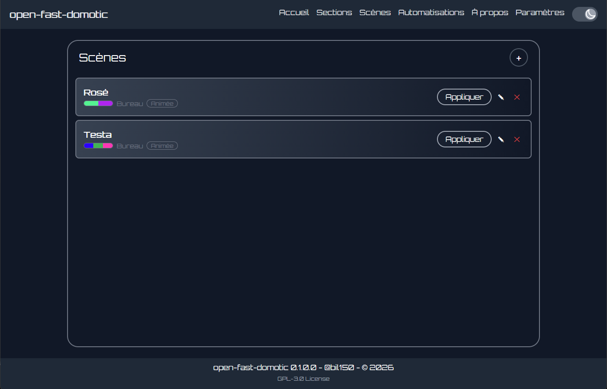
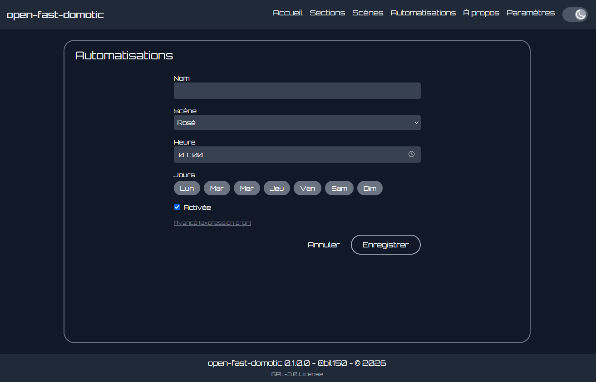
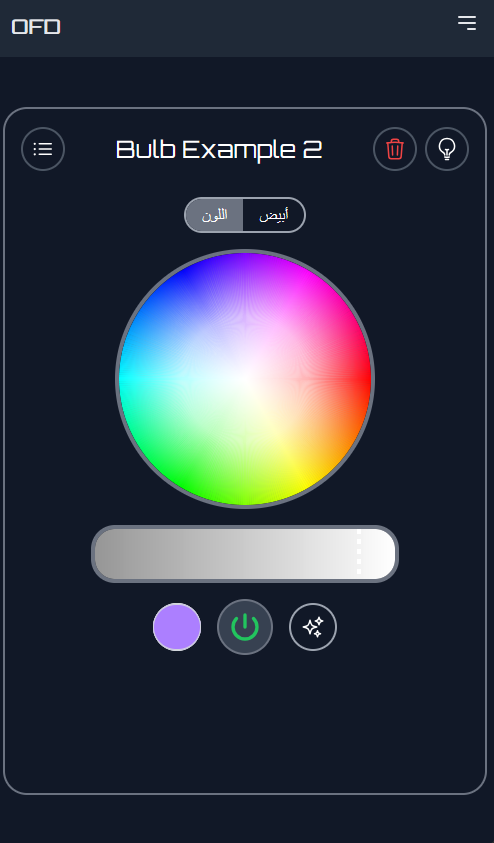

<h1 align="center">OPEN-FAST-DOMOTIC</h1>

<p align="center">
  <a href="LICENSE"></a>
  
  
  
  
</p>

A local hub for a connected home: a REST API on top of [zigpy-znp](https://github.com/zigpy/zigpy-znp) and its React web app. One radio dongle talking directly to your devices, no account, no internet.

A free-time project. Forks are welcome, under the same GPL-3.0 license.

**Languages of the app**: English, Français, Nederlands, العربية (chosen in Settings).

Protocol, brand and product names belong to their owners, with no affiliation: see [Trademarks](#trademarks).

<p align="center">
  
  
</p>
<p align="center">
  
  
</p>
<p align="center">
  
</p>

## Quick start

You need a radio dongle supported by zigpy-znp (ZNP firmware).

**Development** (Windows, Linux, macOS; Python 3.12+, Node 20+):

```sh
git clone https://github.com/bil150/open-fast-domotic.git
cd open-fast-domotic
npm install
npm run setup    # finds the dongle, installs everything, writes .env
npm run dev      # app on http://<ip of the machine>:3001, API on :8000
```

**Docker** (Linux host with the dongle plugged in, Docker Compose 2.24+):

```sh
git clone https://github.com/bil150/open-fast-domotic.git
cd open-fast-domotic
npm install && npm run build && cd build
sh install.sh    # asks for the dongle and your timezone, writes .env, builds, starts
```

Open http://localhost:8000 (API docs on `/docs`), press **+**, put the device in pairing mode (bulb: switch on/off 5 times; socket, sensor: hold the button). The pairing window stays open 60 s.

No dongle? `ENABLE_Z=false` starts the API with an empty device list (VS Code: **Server (no dongle)**).

## Features

- **Lights**: on/off, brightness, color, white. The app shows only what each bulb supports.
- **Sockets**, **temperature sensors**, **batteries**, **buttons** (a press applies a scene, toggles or switches a device).
- **Rooms** (a light is in one room) and **groups** (a light can be in several), with on/off and brighter/dimmer for all their lights.
- **Scenes**: a room or group and 1 to 16 colors, spread over the lights, with a smooth glide (fast 2 s, medium 6 s, slow 15 s). A socket is set on, off or left alone.
- **Animated scenes**: the lights loop through the colors, each starting on a different one.
- **Schedules**: cron-like ("07:30 on weekdays"), run by the server in your timezone.
- **Music mode**: the lights follow the microphone or system sound (the microphone needs HTTPS or `localhost`).
- **FX** on a bulb: flicker, fire, candle.
- **Live**: the app follows the devices through a WebSocket.

A device is recognised by the clusters it announces, not by its model: light (on/off + brightness/color), socket (on/off only), temperature sensor, button. Motion, door, humidity, leak and smoke sensors, blinds, thermostats and locks can be paired but show as "Unknown".

## The dongle

| System | Driver | Port |
|---|---|---|
| Windows | driver of the USB-to-serial chip (often CP210x) | Device Manager, "Ports (COM & LPT)": `COM4` |
| Linux | built in; `sudo usermod -aG dialout $USER`, then log in again | `ls /dev/ttyUSB* /dev/ttyACM*`: `/dev/ttyUSB0` |

**Only one program can open the dongle at a time**: stop the server or the container before starting another.

## Docker

`docker-compose.yml` runs two containers: `server` (the API, the only one using the dongle) and `client` (nginx serving the app and forwarding `/api`). The only published port is 8000.

```sh
sh docker.sh help    # up, down, restart, status, logs, update, backup, restore, import-network
```

All the data (radio network key and paired devices, rooms, scenes, schedules, log) is in the `open-fast-domotic_data` volume. **Back it up** (`sh docker.sh backup`): if `app.db` is lost, every device must be paired again.

**Windows host**: Docker Desktop cannot give a COM port to a container; use WSL2 and [usbipd](https://github.com/dorssel/usbipd-win). In an administrator PowerShell:

```powershell
wsl --install -d Ubuntu
winget install usbipd
usbipd list                                  # BUSID of the CP210x, e.g. 5-1
usbipd bind --busid 5-1                      # once
usbipd attach --wsl Ubuntu --busid 5-1       # each time you plug it or restart WSL
```

Then in Ubuntu: `sudo modprobe cp210x`, and `docker compose up -d --build` from the build folder. While attached to WSL, Windows no longer sees the dongle. macOS cannot give it to Docker: use development mode.

## Development

| Command | |
|---|---|
| `npm run setup` | checks Node/Python, installs everything, finds the dongle (`--yes` no question, `--force` ask the port again, `--skip-install`) |
| `npm run dev` | server + client with live reload (`dev:server`, `dev:client`) |
| `npm run check` | lint + types + tests (client and server, no dongle needed) |
| `npm run build` | check, then the `build/` folder and its zip |
| `npm run release` | build + release gates (same version in `package.json`, `client/package.json`, `server/app/core/config.py`, clean git tree) |
| `npm start` | build the client and serve it from the server on :8000, like Docker |

The app (Vite, port 3001) forwards `/api` to the server (port 8000); both listen on `0.0.0.0`. VS Code: F5 with **Server + Client** (select the `server/.venv` interpreter), Ctrl+Shift+B to build. Set `PYTHON` to use another interpreter.

## Configuration (`.env`)

One `.env` at the root, copied from `.env.example` (`npm run setup` and `install.sh` write it). Docker loads it into the server; the dev server reads it.

| Variable | Default | |
|---|---|---|
| `Z_DONGLE_PATH` | `/dev/ttyUSB0` | dongle port for `npm run dev` (`COM4`). Docker ignores it |
| `Z_DONGLE_DEVICE` | `/dev/ttyUSB0` | Docker only: host device given to the container |
| `TZ` | `UTC` | your timezone: **schedules run in it** |
| `Z_DONGLE_BAUDRATE` | `115200` | |
| `DATA_DIR` | `server/persistence` (`/data` in Docker) | databases and log |
| `DB_PATH` | `<DATA_DIR>/app.db` | radio network database (network key, paired devices) |
| `CORS_ORIGINS` | `*` | allowed web origins, comma separated |
| `RESTORE_ANIMATIONS` | `true` | resume animations and FX after a restart |

## Project structure

```
client/    React + TypeScript + Tailwind (Vite): src/api, hooks, utils, commons/{view,components,subcomponents}
server/    FastAPI + zigpy-znp
  app/api/routes     HTTP layer, routes only
  app/services       business logic; hub.py is the one entry point to devices
  app/repositories   SQL, one class per table (app/models, app/db: tables and sessions)
  app/protocols      BaseCoordinator + one folder per radio protocol (zigpy-znp)
  tests/             pytest with a fake coordinator
scripts/   build.mjs, setup.mjs, install.sh, docker.sh
```

A request goes one way: `routes` → `services` → `repositories` (database) and `protocols` (radio). To add a protocol, implement `BaseCoordinator` and register it in `core/container.py`.

## API

Full documentation on `/docs`. Routes under `/api/v1`:

| | |
|---|---|
| `GET /devices`, `PATCH /devices/{id}` | list, rename |
| `DELETE /devices/{id}` | remove from the network and forget it everywhere (name, rooms, groups, scenes, buttons). Pair it again to get it back |
| `PATCH /devices/{id}/light` | `power`, `brightness` (0-255), `hex_color` or `hue`+`saturation`, `color_temp_kelvin`, `transition_time` |
| `POST /devices/{id}/toggle`, `/refresh` | toggle, read fresh values |
| `GET`/`PUT /devices/{id}/effect`, `DELETE /devices/{id}/animation` | FX (`fire`, `candle`), stop |
| `POST /coordinator/discovery?seconds=60`, `GET /coordinator` | allow pairing, radio status |
| `/rooms`, `/groups` (`GET`, `POST`, `PUT`, `DELETE`) | `{name, device_ids}` |
| `PATCH /rooms/{id}/light`, `/groups/{id}/light`, `/lights` | one order for a room, a group, the whole home |
| `/scenes`, `POST /scenes/{id}/apply`, `/stop` | scenes |
| `/schedules`, `/sequences`, `/buttons` | schedules (5-field cron), sequences of scenes, button actions |
| `WS /ws` | live `{type: state\|button\|joined\|left, device_id, data}` |
| `WS /stream` | send `{device_id, brightness?, hex_color?}` without waiting for answers (music mode) |

A command the device does not acknowledge answers `502`; one it cannot do (color on a white bulb) answers `422`.

A scene:

```json
{
  "name": "Warm evening",
  "target": {"type": "room", "id": 1},
  "palette": [{"hex_color": "#ff8800", "brightness": 200}, {"color_temp_kelvin": 2700}],
  "assignments": {"<light id>": 1},
  "switches": {"<socket id>": true},
  "speed": "medium"
}
```

Light *i* gets color *i* (then it starts over); `assignments` places a light on a given color; `switches` sets sockets and switches off the lights listed with `false` (an unlisted socket is left alone). Add `"animated": true` and `"duration"` (seconds per color, 2 colors at least) for an animated scene: `apply` starts the loop, `stop` ends it, and any other command on one of its lights stops it.

## Troubleshooting

| Symptom | Fix |
|---|---|
| `GET /api/v1/coordinator` says `"ready": false` | dongle not found or busy: read `last_error`, check `Z_DONGLE_PATH` / `Z_DONGLE_DEVICE`, and that nothing else holds the port. The server retries every 30 s |
| Devices "Not responding", `MAC_NO_ACK` in the log | device off, unplugged, out of range or removed |
| A sensor or button shows nothing | battery devices sleep: press their button, then **Refresh** |
| An animated scene stutters | the radio is too slow: fewer lights, a slower speed, a USB extension cable for the dongle. `npm run fade-test -- <device id>` helps to find the cause |
| A schedule runs at the wrong hour | set `TZ` in `.env` |
| "Live updates disconnected" | the WebSocket dropped; it reconnects every 3 s. If it never does in dev, restart `npm run dev` (the Vite proxy reads its config at startup) |
| Every device must be paired again | `app.db` was lost: restore your backup |
| `docker.sh up` cannot find `/dev/ttyUSB0` | set `Z_DONGLE_DEVICE` to the right port |
| `python` not recognized on Windows | use `npm run setup` (it finds Python itself) |

### Talk to the dongle without the server

To check the radio or repair the network. **Stop the server first** (the port opens once), and replace `COM4` with your port (`/dev/ttyUSB0` on Linux).

```sh
pip install zigpy-cli
zigpy -v radio znp COM4 info                  # firmware and network: is the dongle answering?
zigpy -v radio znp COM4 permit                # open pairing
zigpy -v radio znp COM4 backup network.json   # save the network. It holds the network key: keep it private
zigpy -v radio znp COM4 form                  # form a new network: every device must be paired again
zigpy -v radio znp COM4 reset                 # restart the radio
python -m zigpy_znp.tools.nvram_reset COM4    # erase everything on the dongle: every device must be paired again
```

Start with `info`: if it fails, the problem is the port or the driver, not the app.

### Change the radio channel

The radio uses channels 11 to 26. A channel shared with your Wi-Fi gives a slow, unreliable network. 15, 20 and 25 sit between the Wi-Fi channels 1, 6 and 11, and some devices only join on those three.

```sh
zigpy -v radio znp COM4 info                  # "Channel:" is the current one
zigpy -v radio znp COM4 energy-scan           # live noise per channel: pick a quiet one (Ctrl+C to stop)
zigpy -v radio znp COM4 change-channel -c 20  # move the network to channel 20
```

The coordinator tells the paired devices to follow, and they keep their pairing. A sleeping battery device that misses the message is lost: wake it (press its button) or pair it again. Run it with the server stopped, then start the server again.

The server does not choose a channel: it lets zigpy form the network the first time it starts, then keeps it. So change the channel once, with the commands above.

## Contributing

See [CONTRIBUTING.md](CONTRIBUTING.md).

## Trademarks

**Names.** Every protocol, standard, brand, manufacturer, product and model name that appears in this project or in your own system belongs to its owner. Brand, manufacturer and model names shown by the app are reported by your own devices: they are not chosen by this project.

**Independence.** The owners are entirely independent of this project and hold sole ownership of their products, trademarks and intellectual property. This project is not affiliated with, sponsored, approved, certified or endorsed by any of them, and no affiliation or endorsement is implied. It uses no third-party logo.

**Use of the names.** They are used only to identify things and to say what works with what, in good faith. Saying that a device works is an informal statement, not a certification, and not a guarantee that it will work with your device or firmware.

**Third-party software.** The libraries used keep their own names and licenses, listed in [THIRD_PARTY_LICENSES.txt](THIRD_PARTY_LICENSES.txt).

**No warranty.** This project is provided as is, without warranty of any kind (see the license). You use it with devices from other makers at your own risk. Check their terms, warranty and the rules of your country for radio equipment.

**A mention to change?** If you own a name and want its mention changed or removed, open an issue and it will be looked at.

## License

Copyright (C) 2026 @bil150. Free software under the [GNU General Public License v3.0](LICENSE): if you share it, modified or not, it stays under the same license with its source available.
